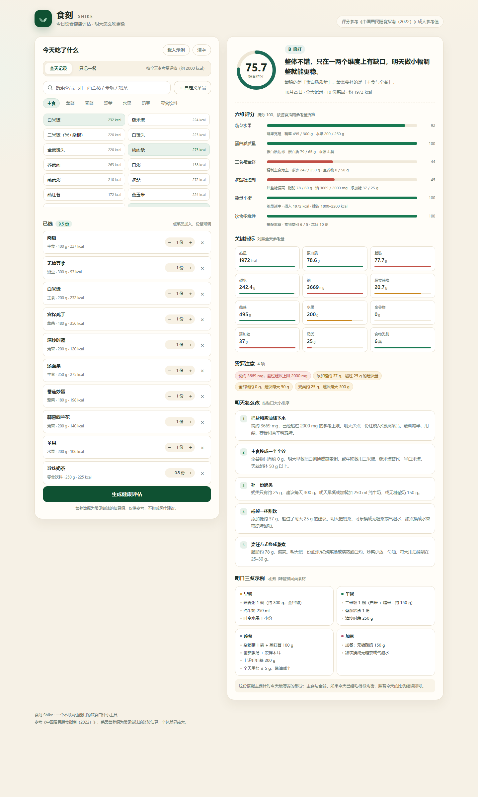

# 食刻 Shike · 今日饮食健康评估

记录今天吃了什么，给出一个 **0–100 分的健康评分**，指出短板，并生成 **明天怎么吃的具体建议和一日三餐示例**。

纯前端实现，无框架、无构建、无后端，双击用任意静态服务器打开即可运行。

**在线体验**：<https://3054718337.github.io/food-health-app/?demo=1>（自动载入示例）· **仓库**：<https://github.com/3054718337/food-health-app>



## 快速开始

```bash
cd food-health-app
python -m http.server 5173
```

浏览器打开 <http://localhost:5173>；想直接看效果可以访问 <http://localhost:5173/?demo=1>（自动载入一份示例饮食）。

> 由于使用 ES Module，直接双击 `index.html` 会被浏览器的跨域策略拦截，需要经由本地服务器打开。任意静态服务器都可以，例如 `npx serve`、`php -S localhost:5173`。

## 它做什么

| 环节 | 说明 |
| --- | --- |
| 录入 | 从 76 道常见中式菜品中搜索或按 7 类浏览；没有的菜可以按类别手动估算 |
| 份量 | 每份 0.5–5 份可调，实时显示克数与热量 |
| 评分 | 蔬菜水果、蛋白质质量、主食与全谷、油盐糖控制、能量平衡、饮食多样性六个维度 |
| 诊断 | 总分换算 A/B/C/D 等级，列出超标或不足的具体指标 |
| 建议 | 按缺口大小排序，最多 5 条可执行动作，附具体克数与替代方案 |
| 明日菜单 | 自动生成早餐 / 午餐 / 晚餐 / 加餐，覆盖今天最缺的部分 |

支持「全天记录」和「只记一餐」两种口径：单餐模式下所有参考量按 0.4 折算，避免用一天的标准去评判一顿饭。

记录保存在浏览器 `localStorage`，刷新不丢，不上传任何服务器。

## 评分模型

参考《中国居民膳食指南（2022）》成人轻体力活动水平的每日推荐量，折合成可计算的阈值：

| 维度 | 权重 | 达标参考 |
| --- | ---: | --- |
| 蔬菜水果 | 25 | 蔬菜 ≥ 300 g，水果 ≥ 250 g |
| 蛋白质质量 | 20 | 蛋白质 ≥ 65 g，且来源覆盖 4 类（畜/禽/水产/蛋/奶/大豆） |
| 主食与全谷 | 20 | 碳水 250 g，全谷物及薯类 ≥ 50 g |
| 油盐糖控制 | 20 | 脂肪 ≤ 60 g，钠 ≤ 2000 mg，添加糖 ≤ 25 g |
| 能量平衡 | 10 | 每日 2000 kcal ± 10% 为满分 |
| 饮食多样性 | 5 | 食物类别 ≥ 5 类，菜品 ≥ 8 份 |

```
综合分 = Σ(维度得分 × 权重)      # 各维度得分先归一化到 0–1
A 优秀 ≥ 85    B 良好 70–84    C 需改进 55–69    D 偏差较大 < 55
```

建议不是一次性文案，而是按规则生成：每条规则先算出该维度的缺口比例，超过 12% 才进入候选，再按缺口从大到小取前 5 条；如果几乎没有短板，则返回「保持现在的结构」。

## 目录结构

```
food-health-app/
├─ index.html                  # 页面骨架
├─ assets/
│  ├─ css/styles.css           # 设计令牌 + 组件样式 + 响应式
│  └─ js/
│     ├─ foods.js              # 76 道菜品营养库（每 100 g）
│     ├─ nutrition.js          # 换算、六维评分、预警与建议生成
│     └─ app.js                # 交互、渲染、本地存储
├─ tests/engine.test.mjs       # 评分引擎单元测试（node:test）
├─ docs/
│  ├─ flowchart.svg            # 流程图
│  ├─ prototype.svg            # 低保真原型（桌面录入 / 桌面结果 / 移动端）
│  ├─ design-system.html       # 设计规范与组件稿
│  └─ screenshots/             # 实际运行截图
├─ package.json
└─ README.md
```

## 测试

```bash
node --test "tests/**/*.test.mjs"     # 或 npm test
```

覆盖：健康日 vs 高油高盐日的分数差、单餐折算、克数换算、蔬菜/钠/糖预警触发、明日三餐非空、手动菜品估算、权重合计为 100。

## 设计文档

- [流程图](docs/flowchart.svg)：用户输入 → 营养换算 → 六维评分 → 短板识别 → 建议生成
- [原型图](docs/prototype.svg)：三个核心界面的线框与交互说明
- [设计规范](docs/design-system.html)：配色、字体、间距、组件与评分呈现规则（浏览器直接打开）

## 部署

已部署在 GitHub Pages：<https://3054718337.github.io/food-health-app/>（`main` / `root`，推送后自动构建）。

Fork 或另建仓库后，同样在 Settings → Pages → Deploy from a branch 选择 `main` / `root` 即可；纯静态站点无需构建步骤。

```bash
git clone https://github.com/3054718337/food-health-app.git
cd food-health-app
python -m http.server 5173
```

## 数据与边界

- 营养值按常见做法估算（每 100 g 可食部），同一道菜因油盐用量差异可达 ±30%。
- 参考量针对 18–49 岁轻体力活动成人；孕产妇、儿童、慢病人群不适用。
- 本工具用于自我观察，不能替代营养师或医生的建议。

## 后续可以做的

- 引入食物称重/常见容器（一碗、一盘）换算，减少份量估算误差
- 增加连续 7 天趋势与周报
- 支持自定义目标体重和活动量，动态计算能量需求
- 菜品库接入《中国食物成分表》标准数据，替换经验值
